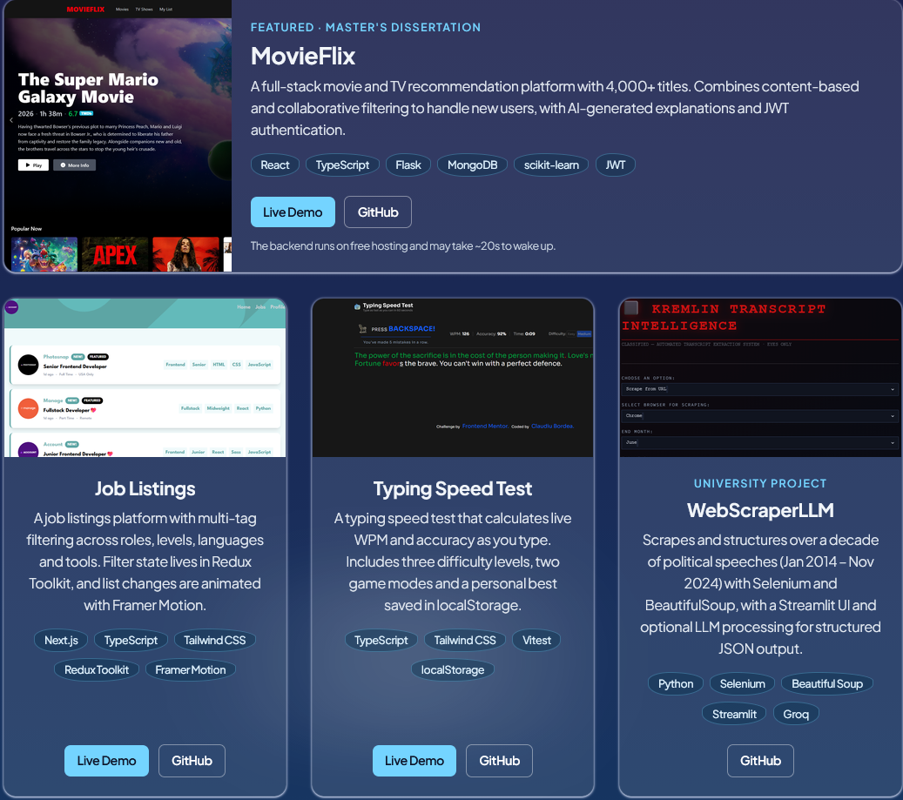

# Claudiu Bordea — Portfolio

Personal portfolio site built with React, Vite, and Tailwind CSS.
Live at: <https://portfolio-beta-liart-55.vercel.app/>



## About

A sky/cloud-themed portfolio showcasing my projects, skills, and background
as a front-end developer, the aesthetic being a play on my name (Claudiu → Cloud).

## Built With

- React
- Vite
- Tailwind CSS
- react-scroll (smooth scrolling and active-section nav)

## Features

- Responsive single-page layout
- Sticky navigation that highlights the section you're viewing
- Animated cloud SVG section dividers (disabled for users who prefer reduced motion)
- Featured project card plus frosted glass project cards with live demo and GitHub links
- Experience and education overview

## Projects Featured

- **MovieFlix** — Full-stack ML-powered movie recommendation platform (Master's dissertation)
- **Job Listings** — Next.js job board with multi-tag filtering and Redux Toolkit
- **Typing Speed Test** — TypeScript typing test with live WPM and accuracy
- **WebScraperLLM** — Political speech scraper with LLM processing (university project)

## Running Locally

```
npm install
npm run dev
```
